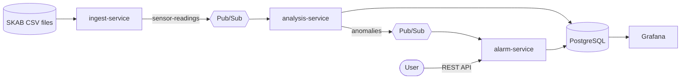

# PumpGuard – Plattform zur Maschinenzustandsüberwachung und Anomalieerkennung

Cloud-native prototype for condition monitoring of an industrial water pump.
PumpGuard replays real sensor data (vibration, temperature, current, pressure) as a live stream,
detects unusual behaviour with rule-based checks and automatically creates maintenance orders.

> 🚧 **Status:** work in progress – course project for *Cloud Native Software Engineering* (WS 2026/27)

## Features

| Feature | Description | Status |
|---|---|---|
| Live monitoring | Sensor data is streamed via Google Cloud Pub/Sub, stored in PostgreSQL and shown live in Grafana | ⏳ planned |
| Rule-based anomaly detection | Threshold rule and trend rule (moving average / slope) detect slowly rising vibration before a limit is exceeded | ⏳ planned |
| Maintenance orders | Related anomalies are grouped into exactly one maintenance order per problem; orders can be listed and closed via REST API | ⏳ planned |

## Architecture

- **ingest-service** – replays SKAB sensor data in its original time intervals and publishes it to Pub/Sub
- **analysis-service** – stores readings idempotently and checks them against threshold and trend rules
- **alarm-service** – groups anomalies into maintenance orders and provides a REST API

## Tech Stack

- Java · Spring Boot (3 services, asynchronous communication via Pub/Sub)
- Google Cloud: Cloud Run, Pub/Sub, Cloud SQL (PostgreSQL)
- Docker · Docker Compose (Pub/Sub emulator, PostgreSQL, Grafana)
- GitHub Actions (build, test, deployment to Cloud Run)

## Cloud-Native Principles

- **12-factor:** configuration via environment variables, stateless services, logs to stdout
- **Dev/prod parity:** the same container images run locally with Docker Compose and in Google Cloud
- **Resilience:** unacknowledged messages are redelivered after a restart – without data loss or duplicates

## Getting Started

_Coming soon._

## Screenshots

_Coming soon._

## Data

This project uses the **SKAB – Skoltech Anomaly Benchmark** dataset:
real sensor data from a water pump test bench with labelled anomalies.
See [`data/SKAB/README.md`](data/SKAB/README.md) for details.

Source: [github.com/waico/SKAB](https://github.com/waico/SKAB) – licensed under GPL-3.0.

## License

Code: MIT – see [LICENSE](LICENSE). Dataset: GPL-3.0 (SKAB).
